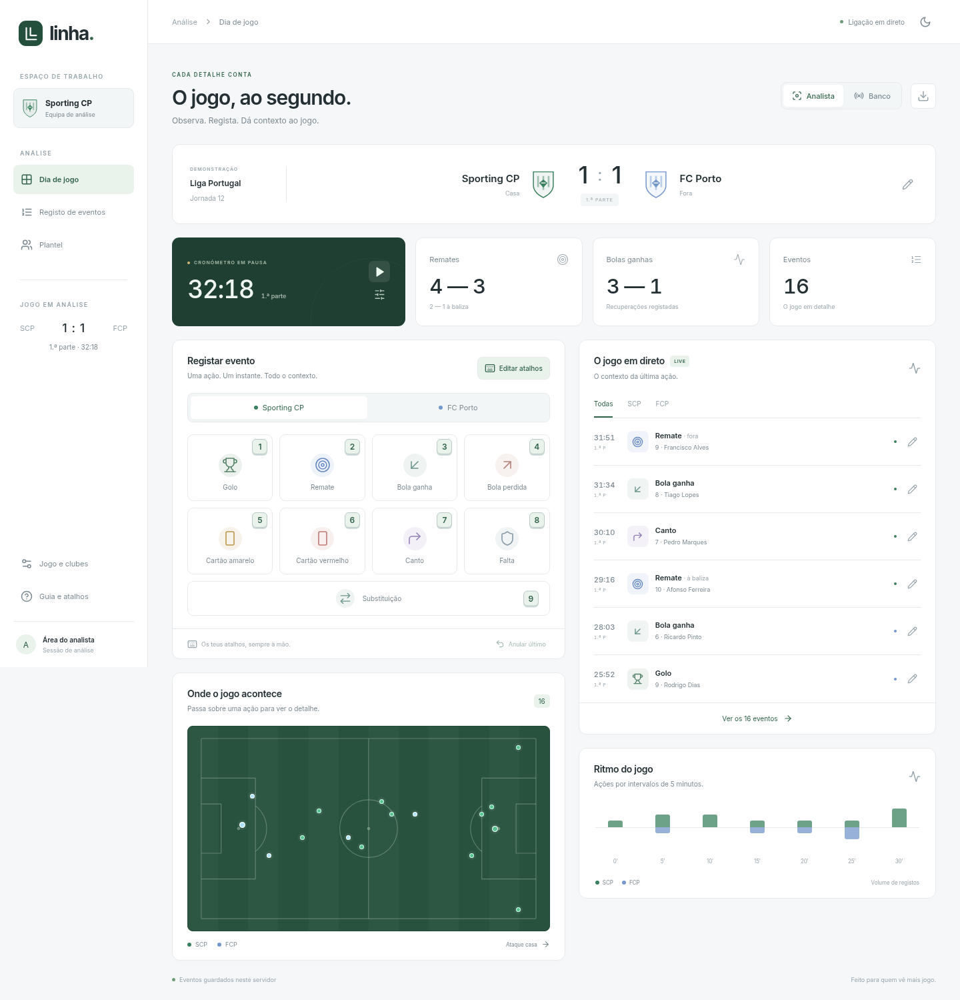
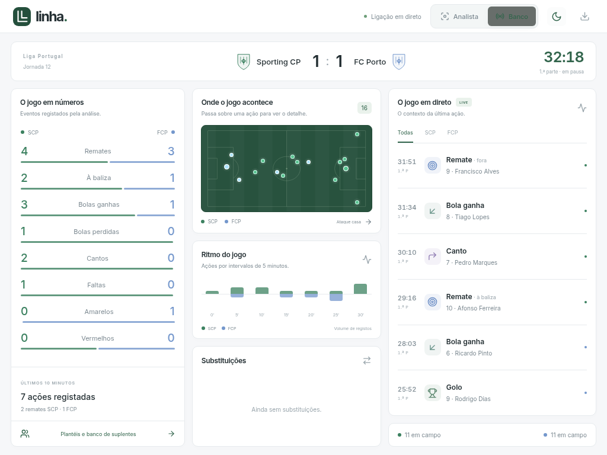
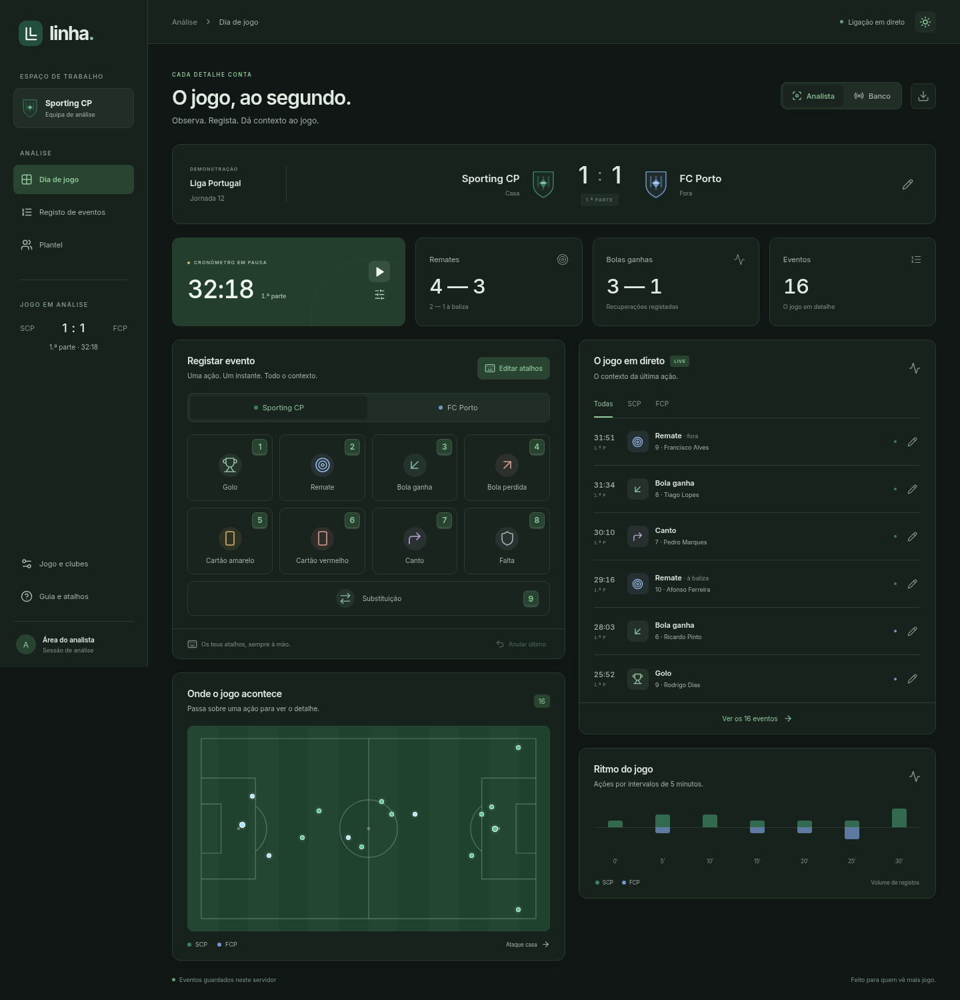

# Linha

Uma primeira versão de um espaço de trabalho para analistas de futebol. Regista os acontecimentos de um jogo, com minuto e segundo, jogador e localização, e partilha o registo com a vista do banco através de Server-Sent Events.



## Desenvolvimento

Requer Node.js 22 ou superior e npm. Na raiz do repositório:

```sh
npm ci --cache /tmp/linha-npm-cache
npm run dev
```

O servidor usa a porta 3000 por predefinição. `PORT` permite selecionar outra porta. O mesmo servidor serve a interface e a API, incluindo a ligação em direto. Para abrir a vista do banco, seleciona **Banco** no painel, ou usa o caminho `/?view=bench` no mesmo servidor acessível ao dispositivo. Os dispositivos têm de conseguir chegar a esse servidor; a aplicação não cria um endereço público nem contorna as regras de rede.

```sh
npm test
npm run build
npm start
```

`npm start` serve o resultado de produção de `npm run build`. As fontes Inter e os ícones SVG são servidos localmente, sem serviços externos em tempo de execução.

## Ver a aplicação

Se não tiveres acesso ao servidor da nuvem, podes experimentar uma demonstração autónoma: descarrega [linha-demo.html](docs/linha-demo.html) e abre o ficheiro no navegador. Não precisa de instalação, servidor ou acesso à Internet. Inclui o mesmo painel, registo de eventos, cronómetro e alternância entre Analista e Banco. Esta demonstração usa dados locais do navegador e não partilha eventos entre dispositivos; não está ligada aos dados do servidor. Os dados locais persistem quando o navegador permite armazenamento para ficheiros locais; caso contrário, duram apenas enquanto a página estiver aberta.

Para gerar novamente esse ficheiro a partir do código atual, executa `npm run demo`.

Para uma pré-visualização da versão compilada, executa `npm run build` e depois `npm run preview` na raiz do projeto. O servidor serve a interface e a API na porta 3000, em todas as interfaces de rede. Se a ferramenta de pré-visualização permitir escolher uma porta, seleciona 3000. Reinicia o servidor quando o ambiente for restaurado: os ficheiros são preservados, mas os processos ativos não.

Um serviço de alojamento apenas de ficheiros estáticos não é suficiente para esta aplicação, porque o registo de eventos e a atualização em direto dependem do servidor Node.js. A vista do banco usa `/?view=bench` no mesmo servidor. Em desenvolvimento, se o proxy de pré-visualização usar um hostname externo, adiciona esse hostname específico à configuração `server.allowedHosts` do Vite; a versão compilada não depende do servidor de desenvolvimento do Vite.

## Fluxo de jogo

1. Escolhe a equipa e a ação. As teclas **1–9** abrem as nove ações por predefinição. Em **Editar atalhos**, podes atribuir letras ou números, desativar ações e alterar o atalho do cronómetro; não são permitidos atalhos repetidos.
2. O instante fica capturado ao escolher a ação. Podes corrigir esse tempo, escolher um jogador, selecionar a zona do campo e acrescentar uma nota.
3. Guarda o evento. O resultado e as estatísticas atualizam-se em todas as vistas ligadas ao servidor.
4. **Espaço** inicia ou pausa o cronómetro. O botão de ajuste permite acertar o tempo e passar à segunda parte, em pausa aos 45:00.
5. **Anular último** remove o último evento que registaste nesta sessão. No histórico podes adicionar, editar ou eliminar eventos. A edição também está disponível nos ícones de lápis do feed em direto. O tempo, a parte, o tipo de evento, a equipa, o jogador, a localização e a nota são editáveis.
6. A exportação CSV inclui tempo, parte, equipa, jogador, entrada numa substituição, localização, resultado do remate e notas.

O campo no formulário também aceita as setas do teclado; Enter seleciona o centro. Os pontos registados mostram minuto, tipo, equipa, jogador e nota ao passar o rato, focar pelo teclado ou tocar. O foco fica na janela de registo até a fechares.

O botão de lua/sol alterna entre os modos claro e escuro. O tema e os atalhos são guardados por navegador, separadamente dos dados do jogo. Atalhos de ação funcionam mesmo com um botão focado; o Espaço respeita a ativação nativa de botões. São desativados em campos de escrita, em janelas abertas e na vista Banco.

### Gestão e substituições

Em **Jogo e clubes**, podes editar os nomes dos clubes, abreviaturas, cores, competição, jornada/fase e estádio. No **Plantel**, podes adicionar ou editar jogadores, números, posições e a escalação inicial (titular ou suplente). Há onze titulares e sete suplentes por equipa na demonstração inicial. Os números são únicos em cada equipa. Identidades estáveis mantêm os eventos ligados ao jogador mesmo quando o seu nome ou número é alterado.

A ação **Substituição** regista quem sai e quem entra. O plantel é calculado pela cronologia dos eventos no instante do cronómetro; corrigir ou anular uma substituição recalcula a escalação. Entradas em conflito com substituições posteriores são rejeitadas, sem alterar o registo. A versão atual usa substituições sem reentrada; jogadores substituídos ou expulsos não podem voltar a entrar. Cartões vermelhos identificados retiram o jogador do conjunto em campo.

### Vista do banco

A vista Banco dispensa a barra lateral e agrupa resultado, clubes e relógio num cabeçalho compacto. Estatísticas, campo, ritmo, seis eventos recentes e três substituições recentes ficam visíveis sem scroll em tablets 1024×768 e 768×1024, e em 1024×600. O botão **Plantéis e banco de suplentes** abre o plantel completo numa janela. Em telemóveis, os cartões passam a uma coluna com scroll.





## Dados e limites desta versão

O jogo, os plantéis e os emblemas são de demonstração; os jogadores são fictícios. O cronómetro começa em pausa aos 32:18. Os eventos são guardados em `.local/match.json`, uma pasta ignorada pelo Git. `MATCH_DATA_DIR` permite selecionar uma pasta diferente. Os dados sobrevivem ao reinício do servidor. A persistência usa um ficheiro JSON e destina-se a uma única instância do servidor.

Os golos contam como remates e remates à baliza. O gráfico de ritmo mostra o volume dos eventos efetivamente registados em blocos de cinco minutos, não uma estimativa de posse, pressão ou xG. As coordenadas são percentagens de um campo fixo: a equipa da casa ataca para a direita e a visitante para a esquerda. Ainda não há inversão automática de campo entre partes.

Esta versão não inclui autenticação nem permissões no servidor. A vista do banco é de leitura na interface; não constitui controlo de acesso à API. Não expor a aplicação a uma rede pública com dados reais antes de implementar autenticação, autorização e sessões separadas de jogo. Ainda não há modo offline: os controlos de escrita são desativados quando a ligação se perde, e o registo continua quando a ligação regressa.

## Próximas decisões de produto

- Sessões para vários jogos, importação de plantéis e mudanças de direção de ataque entre partes.
- Acessos de analista e banco, com permissões no servidor e ligações por jogo.
- Registo rápido de sequências, com seleção do jogador por número e filas de eventos.
- Registo offline com sincronização e resolução de conflitos.
- Marcadores para vídeo e clipes; métricas adicionais apenas quando a recolha as suporte.
